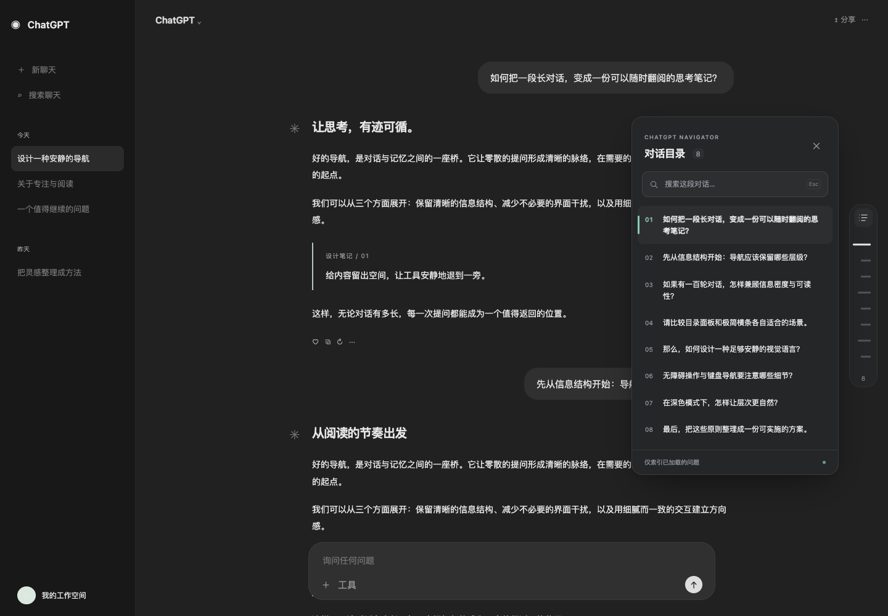

# ChatGPT Navigator

一段长对话，也可以像一份有目录的文档。

轻量、私密的 Chrome Manifest V3 扩展。右侧短横线对应每次用户提问，悬停预览，点击定位。展开后可搜索、浏览问题目录。纯 TypeScript + 原生 DOM，无运行时依赖、服务器或账号。



## 直接安装

本项目已包含可直接加载的 **`dist/`**，无需安装 Node 或运行构建。

1. 在 Chrome 地址栏打开 `chrome://extensions`。
2. 打开右上角「开发者模式」。
3. 点击「加载已解压的扩展程序」，选择本项目的 **`dist` 文件夹**，不是项目根目录，也不是 ZIP 文件。
4. 打开或刷新 `https://chatgpt.com` 中的一段对话。普通聊天和 Projects 中的聊天均在匹配范围内。旧域名 `https://chat.openai.com` 也包含在内。
5. 右侧出现问题横条。没有用户消息时不显示导航。

也可以先下载并解压 [ChatGPT Navigator 1.0.2 安装包](chatgpt-navigator-1.0.2.zip)，再加载其中的文件夹。

**更新扩展：**重新构建后，在扩展管理页点击「重新加载」，再刷新 ChatGPT 标签页。已有标签页不会自动注入更新后的内容脚本。

## 使用

- **悬停短横条**：预览对应提问；代码块显示为 `[代码块]`，不会把代码铺满预览。
- **点击短横条**：定位到提问，自动识别页面实际滚动容器和顶部遮挡。
- **点击目录图标**：展开完整问题目录；再次点击图标、关闭按钮或目录外部即可收起。
- **搜索**：按问题的完整提取文本过滤，多词查询按「都包含」匹配，忽略大小写。代码块内容不参与搜索。
- **键盘**：`Alt + Shift + N` 展开/收起；目录或横条按钮获得焦点后，用 `↑` / `↓` / `Home` / `End` 移动，用 `Enter` / `Space` 跳转。`Esc` 优先清空搜索，再收起目录。
- **长对话**：横条采用有最小点击高度的滚动轨道，当前节点自动保持可见。桌面预览最多展示九行。
- **窄窗口**：保留目录入口；小于 480px 时隐藏横条。选择问题后自动收起面板。
- **主题**：跟随页面主题，未检测到明确主题时使用系统偏好。遵循 `prefers-reduced-motion` 和高对比度模式。

## 历史加载与定位边界

扩展只知道**实际加载进页面 DOM 的问题**，无法知道从未出现过的历史消息数量或内容。

- 本次页面会话中识别过、带稳定消息 ID 的提问，如果随后被页面卸载或回收，会保留摘要并标记「未加载」。点击会明确提示，**不会假装跳转成功**。
- 可以手动向上滚动，让 ChatGPT 加载历史。对应消息重新进入 DOM 时，目录会恢复可用状态。
- 没有稳定 ID 的降级消息，移出 DOM 后会从目录移除，避免用文本猜测身份或把相同问题合并。
- 编辑、重新生成或切换分支时，页面可能移除旧消息。仅凭公开 DOM 不能始终区分「虚拟化」与「旧分支」。已知但不在 DOM 的条目统一标记不可直接定位；刷新页面可清空缓存。
- 最后一轮若受到页面底部滚动边界限制，会停在浏览器能到达的最近位置。定位后会复核并进行有限次数校正；用户滚轮、触摸或滚动键会取消自动校正。
- 目前同时兼容旧版 role 属性和新版 `data-chatgpt-search-unit-key` / `data-turn-key` 属性。ChatGPT 再次更换 DOM 属性或使用无法访问的封闭组件时，需要更新 `src/dom.ts`。不会通过内部接口绕过这些边界。

## 隐私和权限

- 没有 `permissions`、`host_permissions`、后台服务、统计或第三方脚本。仅声明两个 ChatGPT 域名的内容脚本匹配范围。
- 内容脚本必须读取当前页面 DOM 才能生成目录；浏览器可能因此提示它可以读取/更改这两个域名的数据。
- 提问摘要只存在当前标签页内存中。没有网络请求、存储 API、聊天日志、遥测或 API Key。
- 页面关闭、路由切换、内容脚本销毁后释放相应状态。禁用扩展时检测失效上下文并移除 UI；重新启用后请刷新网页。
- 运行在 Chrome 的隔离脚本环境；Shadow DOM 隔离样式。聊天文字通过 `textContent` 写入，不作为 HTML 执行。

## 开发

需要 Node.js 22+。构建依赖锁定在 `package-lock.json`。

```sh
npm ci --ignore-scripts
npm run typecheck
npm run build
npm run dev
```

`dev` 监听源文件并更新构建；每次在 Chrome 重新加载扩展和网页以应用变更。`public/` 中的 manifest 或图标变化需要重启构建。

## 测试

```sh
# 浏览器也放在项目目录，避免全局安装。
PLAYWRIGHT_BROWSERS_PATH=.browsers npx playwright install chromium
npm test
# 可选：显示独立测试浏览器窗口
HEADED=1 npm run test:ui
```

测试启动临时独立浏览器配置，加载真正的 `dist/` 扩展，通过请求拦截提供模拟 ChatGPT 页面。不会使用你的 Chrome 配置，也不需要登录。可用 `CHROME_PATH` 指定支持 `--load-extension` 的 Chromium 二进制；部分品牌版 Chrome 不支持此启动参数。

测试覆盖安装注入、顺序识别、动态消息、SPA/Projects 路由、嵌套/根滚动、平滑滚动、布局变化、历史回收、搜索、主题、响应式、键盘、重新注入和真正禁用/启用。结果详见 [测试记录](docs/TESTING.md)。

**当前验收边界：**1.0.2 已在本机 Chrome 的真实登录态验证普通聊天 → Projects → 返回普通聊天时导航自动恢复；另已验证导航显示、展开目录和问题跳转。新增消息等完整场景仍以自动化模拟验证为主。文档截图继续使用合成页面，不保存真实聊天截图。详细记录见测试记录。

## 结构与调试

```text
src/
  index.ts      初始化、路由检测、观察器与清理
  dom.ts        消息属性、语义降级、滚动容器与顶部遮挡
  store.ts      当前对话的内存索引、稳定 ID、历史回收
  text.ts       安全文本提取、代码折叠、摘要
  scroll.ts     位置缓存、高亮、定位与有限校正
  ui.ts         Shadow DOM、搜索、预览、键盘、主题
  styles.css    浅色/深色、响应式、动画、可访问性
public/         Manifest V3、图标
scripts/        构建和图标生成
tests/         模拟页面与真实扩展浏览器测试
dist/          可直接加载的扩展
docs/          架构、测试记录与界面预览
```

更多实现取舍见 [架构说明](docs/ARCHITECTURE.md)。图标是原生几何图形，由 `node scripts/icons.mjs` 可重复生成。

调试时使用 ChatGPT 页面的开发者工具：在 Elements 中查找 `#chatgpt-navigator` 和它的 Shadow Root。在 Console 的执行环境选择扩展隔离上下文，可用 `globalThis.__chatgptNavigator.destroy()` 暂时清理实例；刷新网页恢复。生产版本不输出提问内容。

常见问题：

- **看不到导航**：确认加载的是 `dist/`、网址为匹配域名、页面至少有一条已加载的用户消息；安装/更新/重新启用后刷新网页。
- **搜索没有结果**：检查关键词是否在提问文本中；代码块正文不会进入目录索引。
- **某项「未加载」**：手动向上滚动加载历史；如果切换过分支，确认当前分支或刷新页面。
- **点击后位置不理想**：等待图片或回答布局稳定后再点击；检查网站是否有新的固定遮挡区域或多层滚动结构。
- **网站更新后完全失效**：优先检查 `data-message-author-role`、`data-message-id` 和语义 turn 结构，并扩展 DOM 适配器；不要添加全页面文本猜测或内部聊天 API。

## 卸载

在 `chrome://extensions` 中移除 ChatGPT Navigator，并刷新已打开的 ChatGPT 页面。删除本项目即可移除本地源代码、构建、项目依赖、测试浏览器和测试配置；无需修改系统设置。`node_modules/`、`.browsers/` 和 `test-results/` 均可单独删除并按开发步骤重建。

## 规范参考

[Chrome Content scripts](https://developer.chrome.com/docs/extensions/develop/concepts/content-scripts) · [Manifest content_scripts](https://developer.chrome.com/docs/extensions/reference/manifest/content-scripts)
